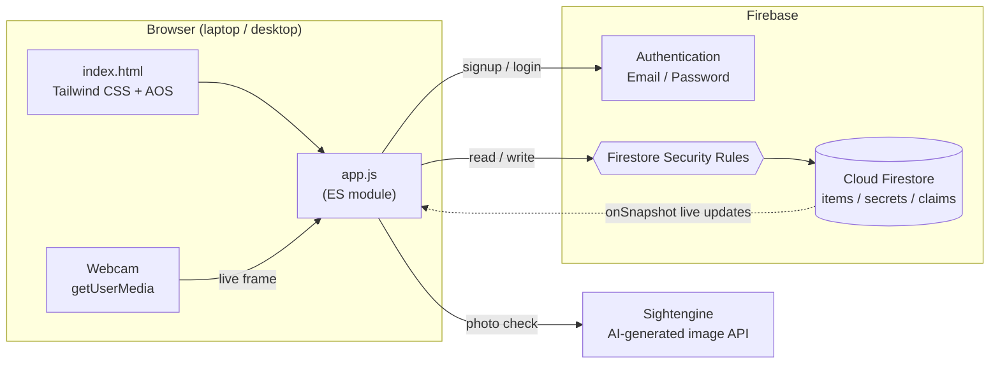
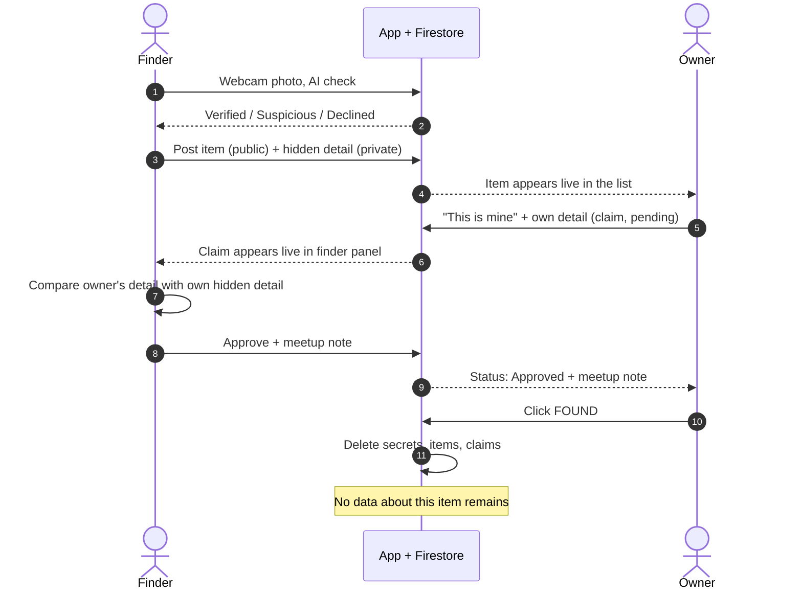
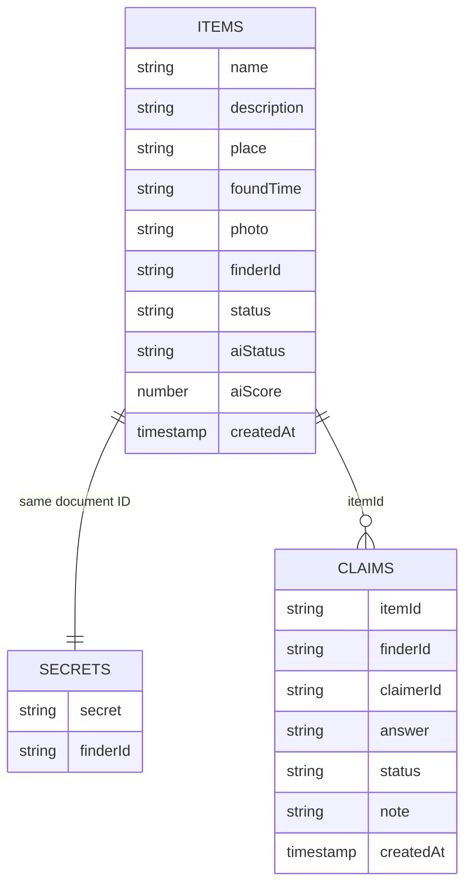
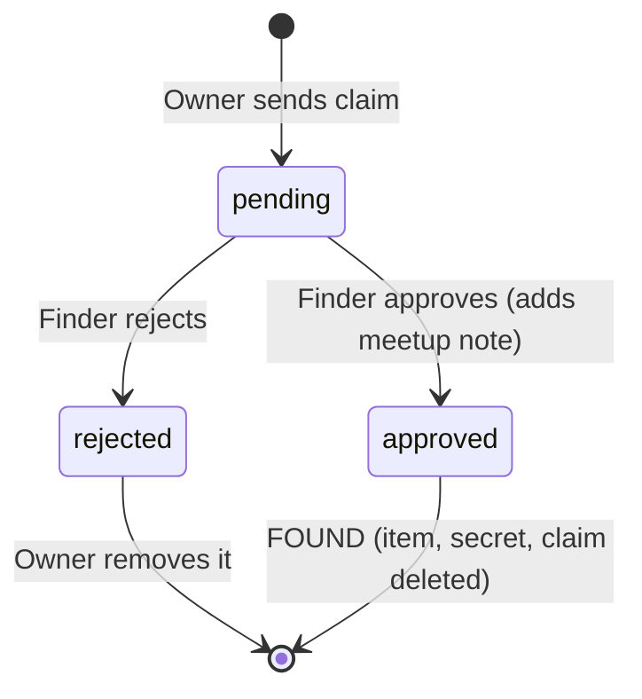

# 🔍 AI-Powered Lost & Found

> **Return lost items. Leak nothing.**
> A privacy-first lost & found web app where the finder's proof stays hidden, the owner is verified without sharing any contact details, and every trace of the item is deleted the moment it is returned.

Built for a hackathon. Desktop / laptop first.

---

## Table of Contents

1. [The Problem](#the-problem)
2. [Our Solution](#our-solution)
3. [Features](#features)
4. [System Architecture](#system-architecture)
5. [End-to-End Flow](#end-to-end-flow)
6. [Data Model](#data-model)
7. [Claim Lifecycle](#claim-lifecycle)
8. [Feature to Code to Data Mapping](#feature-to-code-to-data-mapping)
9. [Access Control Mapping](#access-control-mapping)
10. [AI Photo Check](#ai-photo-check)
11. [Tech Stack](#tech-stack)
12. [Project Structure](#project-structure)
13. [Setup and Run](#setup-and-run)
14. [Firestore Security Rules](#firestore-security-rules)
15. [Privacy and Security Notes](#privacy-and-security-notes)
16. [Known Limitations](#known-limitations)
17. [Roadmap](#roadmap)
18. [Team](#team)

---

## The Problem

| Pain point | What goes wrong today |
|---|---|
| **False claims** | Anyone can say "that's mine" and walk away with someone else's belongings. |
| **Privacy leaks** | Finders and owners must share phone numbers or emails with strangers. |
| **Fake proof** | AI-generated photos make it easy to post or claim items that never existed. |

## Our Solution

1. The **finder** posts the item with a **live webcam photo**, place, time and a **hidden detail** (for example, "there is a blue pen inside").
2. The **owner** sends a claim by describing a detail only the real owner would know. The owner never sees the finder's hidden detail, so it cannot be copied.
3. The **finder** compares both details and approves or rejects the claim.
4. On approval the owner gets a meetup note **inside the app** (no phone number or email is shared).
5. When the owner clicks **FOUND**, the item, the hidden detail and the claim are **deleted together**.

## Features

- Email and password signup, login and logout (Firebase Authentication)
- Post a found item: name, description, place, time, live photo, hidden detail
- Live item list for every logged-in user, no refresh needed
- Claim flow with a claim status panel for both finder and owner
- Approve or reject with a private meetup note
- **FOUND** button that deletes the item, secret and claim
- Webcam-only photo capture (no gallery upload for the item photo)
- AI-generated image detection with three outcomes: verified, suspicious, declined
- Server-enforced access rules (Firestore Security Rules)
- Safe text rendering (user input is never injected as HTML)

## System Architecture



## End-to-End Flow



## Data Model

Three Firestore collections. `items` and `secrets` share the **same document ID**, but live in different collections so the private part can be locked down independently.



Notes:

- `finderId` and `claimerId` are anonymous Firebase user IDs. **No email or phone number is stored** in any collection.
- `photo` is a resized (about 600 px) JPEG stored as text, so Firebase Storage is not needed.
- Claim document ID is `itemId_claimerId`, so one user can have only one claim per item.

## Claim Lifecycle



## Feature to Code to Data Mapping

| Feature | Where in the UI | Main logic in `app.js` | Firestore / external service |
|---|---|---|---|
| Signup / login / logout | Login card | `createUserWithEmailAndPassword`, `signInWithEmailAndPassword`, `signOut`, `onAuthStateChanged` | Firebase Authentication |
| Show / hide screens | Login box vs dashboard | `onAuthStateChanged` toggles `hidden` class | Auth state |
| Webcam photo | "Webcam se photo lo" button | `getUserMedia`, canvas resize, `photoData` | None (in browser) |
| AI photo check | After the photo is taken | `checkPhoto()` and the `cam-snap` listener | Sightengine `genai` model |
| Post found item | Left form | `addDoc` to `items`, `setDoc` to `secrets/{sameId}` | `items`, `secrets` |
| Live item list | Right column, "Mile hue items" | `onSnapshot` on `items`, `renderItem()` | `items` |
| Send a claim | "Ye meri cheez hai" on an item | `setDoc` to `claims/{itemId_claimerId}` | `claims` |
| Finder claim panel | "Aaye hue claims" | `onSnapshot` on `claims` where `finderId == me` and `status == pending`; `getDoc` on `secrets` | `claims`, `secrets` |
| Approve / reject | Buttons in the claim card | `updateDoc` (`status`, `note`) | `claims` |
| Owner claim panel | "Meri claims" | `onSnapshot` on `claims` where `claimerId == me`, `renderMyClaim()` | `claims` |
| FOUND (delete all) | Button after approval | `deleteDoc` on `secrets`, `items`, then `claims` | all three collections |
| Safe rendering | Everywhere | `makeEl()` uses `textContent`, never `innerHTML` for user data | n/a |

## Access Control Mapping

Who can do what, enforced by **Firestore Security Rules on the server** (not just by the UI).

| Collection | Read | Create | Update | Delete |
|---|---|---|---|---|
| `items` | Any logged-in user | Logged-in user, only as themselves (`finderId == uid`) | Not allowed | The finder, or the owner whose claim is `approved` |
| `secrets` | **Only the finder** | Only the finder | Not allowed | The finder, or the owner whose claim is `approved` |
| `claims` | Only the finder and the claimer of that claim | Claimer only; not on own item; status must be `pending`; ID must be `itemId_uid` | Finder only; only `status` and `note` may change; status must become `approved` or `rejected` | The claimer or the finder |

## AI Photo Check

Each webcam photo is sent to Sightengine's AI-generated image model, which returns a score from 0 to 1.

| Score | Result | What the app does |
|---|---|---|
| below 0.3 | `verified` | Posts with a green "Real photo verified" badge |
| 0.3 to 0.7 | `suspicious` | Posts with an "Unverified photo" badge |
| 0.7 and above | `declined` | Post is blocked, user must take a real photo |
| API error | `unchecked` | Post goes through without a badge (the app never crashes) |

**Trust is layered, because no AI detector is 100% accurate:**

1. **Live webcam capture:** blocks direct gallery uploads of AI images.
2. **AI score:** flags likely AI-generated photos.
3. **Hidden detail:** the real proof of ownership, checked by the finder.

The thresholds (0.3 and 0.7) are tunable in `app.js`.

## Tech Stack

| Layer | Technology |
|---|---|
| Frontend | HTML, Tailwind CSS (CDN), JavaScript (ES modules), AOS animations |
| Auth | Firebase Authentication (Email / Password) |
| Database | Cloud Firestore with real-time `onSnapshot` listeners |
| Security | Firestore Security Rules |
| AI | Sightengine AI-generated image detection (`genai` model) |
| Camera | Browser `getUserMedia` API |
| Dev server | VS Code Live Server |

## Project Structure

```text
hackathon-project/
├── index.html    # Login page and dashboard (Tailwind UI)
├── app.js        # Firebase setup, auth, posting, claims, AI check, webcam
├── style.css     # Fonts (Inter + Playfair Display)
├── hero.svg      # Optional illustration (hidden automatically if missing)
└── README.md
```

## Setup and Run

### 1. Clone

```bash
git clone https://github.com/<your-username>/<your-repo>.git
cd <your-repo>
```

### 2. Create a Firebase project

1. Open the [Firebase console](https://console.firebase.google.com) and create a project (Google Analytics can stay off).
2. Add a **Web app** (`</>`), do not enable Hosting, and copy the `firebaseConfig`.
3. **Authentication:** enable the **Email/Password** sign-in method.
4. **Firestore Database:** create a database, then publish the rules from [Firestore Security Rules](#firestore-security-rules).

### 3. Add your config to `app.js`

```js
const firebaseConfig = {
  apiKey: "YOUR_FIREBASE_API_KEY",
  authDomain: "YOUR_PROJECT.firebaseapp.com",
  projectId: "YOUR_PROJECT_ID",
  storageBucket: "YOUR_PROJECT.appspot.com",
  messagingSenderId: "YOUR_SENDER_ID",
  appId: "YOUR_APP_ID"
};
```

### 4. (Optional) Enable the AI photo check

Create a free account at [Sightengine](https://sightengine.com) and set:

```js
const SE_USER = "YOUR_SIGHTENGINE_API_USER";
const SE_SECRET = "YOUR_SIGHTENGINE_API_SECRET";
```

If these are missing or invalid, the app still works and photos are posted as `unchecked`.

> ⚠️ **Never commit real Sightengine keys to a public repository.** See [Privacy and Security Notes](#privacy-and-security-notes).

### 5. Run

Open the folder in VS Code, right-click `index.html` and choose **Open with Live Server**. Use a normal window and an incognito window to test two users (finder and owner) side by side. Allow webcam access when the browser asks.

## Firestore Security Rules

```text
rules_version = '2';
service cloud.firestore {
  match /databases/{database}/documents {

    // Items: public part, readable by any logged-in user
    match /items/{itemId} {
      allow read: if request.auth != null;
      allow create: if request.auth != null
                    && request.resource.data.finderId == request.auth.uid;
      allow delete: if request.auth != null
                    && (resource.data.finderId == request.auth.uid
                        || get(/databases/$(database)/documents/claims/$(itemId + "_" + request.auth.uid)).data.status == "approved");
    }

    // Secrets: ONLY the finder can read
    match /secrets/{itemId} {
      allow read: if request.auth != null
                  && resource.data.finderId == request.auth.uid;
      allow create: if request.auth != null
                    && request.resource.data.finderId == request.auth.uid;
      allow delete: if request.auth != null
                    && (resource.data.finderId == request.auth.uid
                        || get(/databases/$(database)/documents/claims/$(itemId + "_" + request.auth.uid)).data.status == "approved");
    }

    // Claims: only the finder and the claimer can see them
    match /claims/{claimId} {
      allow read: if request.auth != null
                  && (resource.data.claimerId == request.auth.uid
                      || resource.data.finderId == request.auth.uid);
      allow create: if request.auth != null
                    && request.resource.data.claimerId == request.auth.uid
                    && request.resource.data.finderId != request.auth.uid
                    && request.resource.data.status == "pending"
                    && claimId == request.resource.data.itemId + "_" + request.auth.uid;
      allow update: if request.auth != null
                    && resource.data.finderId == request.auth.uid
                    && request.resource.data.diff(resource.data).affectedKeys().hasOnly(["status", "note"])
                    && request.resource.data.status in ["approved", "rejected"];
      allow delete: if request.auth != null
                    && (resource.data.claimerId == request.auth.uid
                        || resource.data.finderId == request.auth.uid);
    }
  }
}
```

**Quick proof it works:** in the Firebase console, open **Firestore, Rules, Rules Playground**, simulate a **get** on `/secrets/<any-id>` as an authenticated user who is not the finder. The result should be **Denied**.

## Privacy and Security Notes

- **No contact sharing:** emails are used only for login by Firebase Authentication and are never copied into `items`, `secrets` or `claims`. Only anonymous user IDs are stored.
- **Hidden detail is isolated:** stored in its own collection and readable only by the finder, enforced on the server.
- **Delete on completion:** FOUND removes the item, the secret and the claim.
- **Safe rendering:** user text is placed with `textContent`, so injected HTML or scripts do not run.
- **Firebase web config is not a secret.** It identifies your project, and your **Security Rules** are what protect the data.
- **The Sightengine secret is a real secret.** In this demo it sits in client-side code, which is acceptable only for a local demo. Do not commit or deploy it publicly. If a real key was ever committed, revoke it and create a new one. For production, move the AI check to a server or Cloud Function.

## Known Limitations

- **No mobile push notifications.** Users see new items and claims through live in-app updates while the app is open.
- The AI check runs in the browser, so the API key is exposed (see above).
- AI detectors give probabilities, not proof, and can be wrong in both directions. The hidden detail is the final check.
- The webcam layer blocks gallery uploads, but cannot stop someone from photographing an AI image shown on another screen.
- The finder is the only verifier. There is no rating or report system yet.
- Desktop and laptop only for now; the item photo needs a webcam.

## Roadmap

- [ ] Push notifications (Firebase Cloud Messaging)
- [ ] Mobile-friendly layout and mobile app
- [ ] Map pin for where the item was found
- [ ] Auto-expiry of old posts and unclaimed items
- [ ] Server-side AI check (Cloud Functions) so no API key is in the browser
- [ ] Finder-side "remove my post" button
- [ ] Ratings and a report button

## Team

| Name | Role |
|---|---|
| _Your name_ | _Role_ |
| _Teammate_ | _Role_ |

---

_Built with Firebase, Tailwind CSS and Sightengine._
